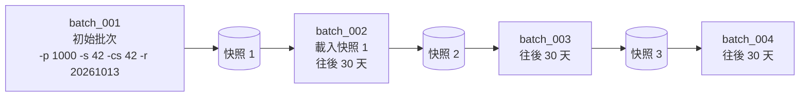
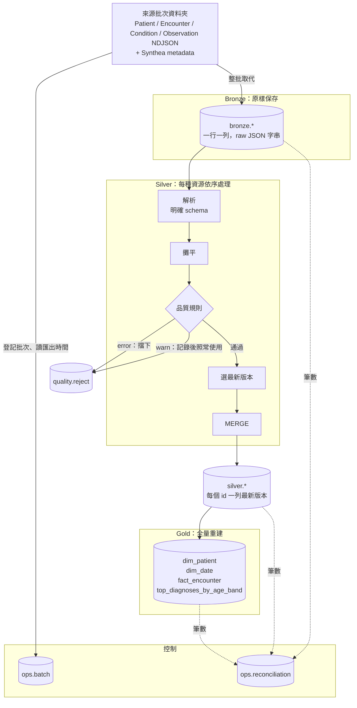
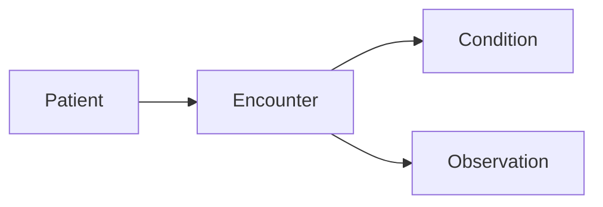
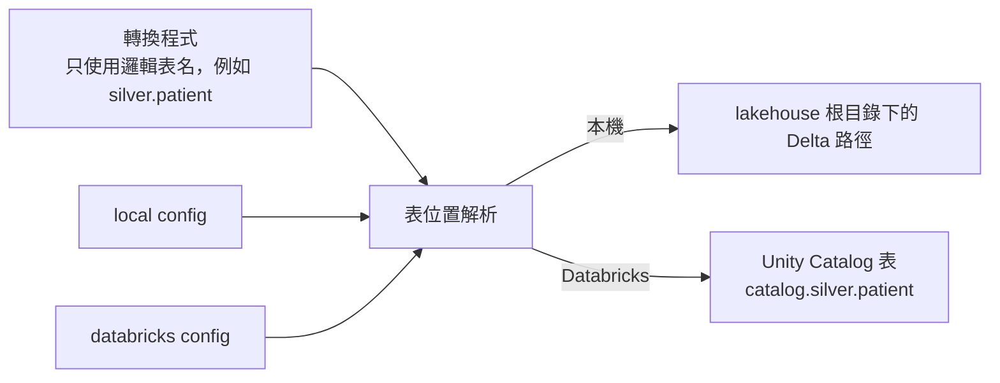

# 架構

把 Synthea 產生的 FHIR R4 合成病歷，一批一批整理成 Bronze → Silver → Gold。同一份程式可以在本機和 Databricks 上跑。

表結構見 [data-model.md](data-model.md)，名詞見 [GLOSSARY.md](../GLOSSARY.md)，設計理由見 [docs/adr/](adr/)。

## 批次怎麼產生

一個初始批次加上三個更新批次，模擬來源系統每個月更新一次（[ADR-0002](adr/0002-update-batches-from-snapshots.md)）。

- 每一批都是 Synthea 的完整匯出（最近 10 年），不是只有變動的部分。
- 某個 id 這一批沒有出現，代表掉出了匯出範圍，不是被刪除。
- 每一批都要靠上一批的快照才能產生，所以批次一定依序產生。

## 一批資料怎麼流過各層

### 各步驟做什麼

| 步驟 | 做什麼 | 決策 |
|---|---|---|
| 登記批次 | 寫入 `ops.batch`，從 metadata 讀匯出時間。同一種資源有多個檔案就讓該批失敗 | LESSONS.md |
| Bronze | 每一行原封不動存成一列，記下批次、來源檔、行號。重跑時整批取代 | [ADR-0003](adr/0003-bronze-raw-json.md) |
| 解析 | 用每種資源的明確 schema 解析 JSON，算出有效更新時間 | [ADR-0001](adr/0001-version-ordering.md) |
| 攤平 | 一列進、一列出，把巢狀欄位展開成平的欄位。缺值填 null，不丟任何一列 | |
| 品質規則 | 每條規則對每一列做檢查，違規就寫一筆 reject 紀錄；`error` 擋下，`warn` 照常使用 | [ADR-0004](adr/0004-reject-table-and-severity.md) |
| 選最新版本 | 在通過檢查的資料中，同一個 id 只留最新的一版；被淘汰的記一筆 `warn` | [ADR-0001](adr/0001-version-ordering.md) |
| MERGE | 新的 id 就新增；版本較新且內容有變就更新；其他不寫 | [ADR-0005](adr/0005-incremental-write.md) |
| Gold | 從 Silver 全量重算並覆寫 | [ADR-0005](adr/0005-incremental-write.md)、[ADR-0006](adr/0006-fhir-id-as-key.md) |
| 核對 | 每一層的筆數寫進 `ops.reconciliation`，任何一項不通過，該批就記為 `failed` | |

### 資源的處理順序

同一批裡，四種資源依照參照關係依序處理，每種處理完就先 MERGE 進 Silver，下一種資源檢查參照時才查得到：

- Encounter 檢查「參照的病人存在」，查的是 `silver.patient`。
- Condition 和 Observation 檢查「參照的 Encounter 存在」，查的是 `silver.encounter`。
- 被擋下的資料不會進 Silver，所以指向它的資料也會被擋下（連鎖擋下）。

## 三種增量

| 種類 | 做不做 | 怎麼做 |
|---|---|---|
| 抽取增量 | 不做 | Synthea 每批都是完整匯出 |
| 計算增量 | 做 | 每次只解析、檢查新批次的 Bronze 資料 |
| 寫入增量 | Silver 做，Gold 不做 | Silver 只寫新增和有變的列；Gold 每次全量重建 |

因為版本比較舊的資料不會寫入，**批次的處理順序不影響最後結果**，在後面的批次之後重跑前面的批次，也不會把資料改回舊版。

## 平台

| | 本機 | Databricks 免費版 |
|---|---|---|
| Spark session | 入口程式自己建立，加上 Delta 設定 | 使用平台提供的 session |
| 表 | lakehouse 根目錄下的 Delta 路徑 | Unity Catalog 受管理表 |
| 來源資料 | 本機的批次資料夾 | Unity Catalog Volume |
| 時區 | 固定 UTC | 固定 UTC |

程式碼的限制：不使用 RDD 和 SparkContext（serverless 不支援）。本機和 Databricks 都用 Python 3.12。詳見 [ADR-0007](adr/0007-platform-portability.md)、[ADR-0008](adr/0008-timezone-and-dates.md)。

## 執行方式

只有一個入口：「處理一批」。輸入環境、`batch_id` 和來源資料夾，依序跑完登記、Bronze、Silver（四種資源）、Gold、核對。

- 本機：從命令列執行。
- Databricks：用 Git 資料夾連接 repo，notebook 呼叫同一個入口。
