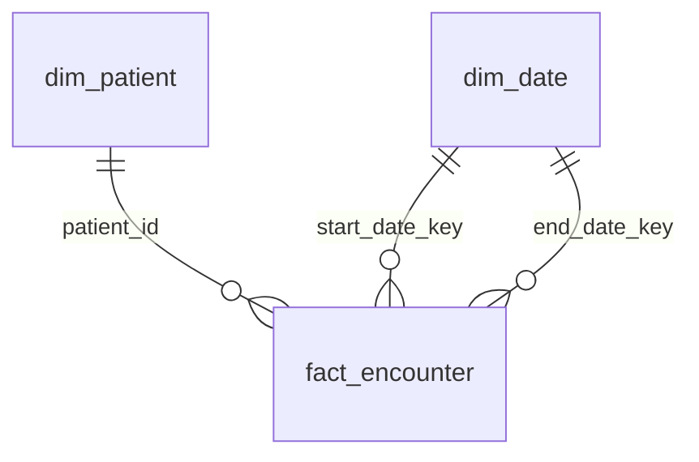

# 資料模型

Bronze、Silver、Gold 和控制表的表結構與主鍵。名詞的定義見 [GLOSSARY.md](../GLOSSARY.md)，設計理由見 [docs/adr/](adr/)。

表名都是邏輯表名（`層.表`），實際位置由各環境的 config 決定（[ADR-0007](adr/0007-platform-portability.md)）。

## 共通規則

- 以 `_` 開頭的是**簿記欄位**，不是業務資料，也不計入內容雜湊值。
- 簿記欄位中的 `_loaded_at`、`_updated_at`、`_detected_at`、`_checked_at`、`started_at`、`finished_at` 是**稽核欄位**，判斷「重跑一致」時排除。
- 日期欄位（`*_date`、`date_key`）一律是**記錄日期**，也就是時間字串上原本寫的日期，不從 timestamp 換算（[ADR-0008](adr/0008-timezone-and-dates.md)）。
- 時間欄位（`*_at`）是 timestamp，保存正確的絕對時間。

## 控制表

### `ops.batch`：批次登記

一列 = 一個批次。

| 欄位 | 型別 | 說明 |
|---|---|---|
| `batch_id` | string | **主鍵**。格式固定為 `batch_NNN` |
| `batch_seq` | int | 批次序號，取自 `batch_id` 的數字部分，唯一 |
| `source_dir` | string | 來源資料夾 |
| `export_time` | timestamp | 匯出時間，取自 Synthea metadata 的 `runStartTime` |
| `seed` | long | Synthea 種子 |
| `clinician_seed` | long | Synthea 醫師種子 |
| `status` | string | `running`、`succeeded`、`failed` |
| `started_at` | timestamp | 稽核欄位 |
| `finished_at` | timestamp | 稽核欄位 |

### `ops.reconciliation`：筆數核對

一列 = 一批 × 一張表 × 一項核對。

| 欄位 | 型別 | 說明 |
|---|---|---|
| `batch_id` | string | 主鍵之一 |
| `layer` | string | 主鍵之一。`bronze`、`silver`、`gold` |
| `table_name` | string | 主鍵之一。邏輯表名 |
| `check_name` | string | 主鍵之一。核對項目名稱 |
| `expected` | long | 預期筆數 |
| `actual` | long | 實際筆數 |
| `passed` | boolean | `expected = actual` |
| `detail` | string | 補充說明，例如 Silver 各去向的筆數 |
| `_checked_at` | timestamp | 稽核欄位 |

核對項目：

| 層 | 核對 | 預期 | 實際 |
|---|---|---|---|
| Bronze | 來源行數 | 來源檔的行數 | 該批寫入 Bronze 的列數 |
| Silver | 去向完整 | 該批 Bronze 列數 | 擋下 + 同批重複淘汰 + 過期 + 未變 + 新增 + 更新 |
| Gold | 病人 | `silver.patient` 列數 | `gold.dim_patient` 列數 |
| Gold | 就診 | `silver.encounter` 列數 | `gold.fact_encounter` 列數 |
| Gold | 日期連續 | 最小到最大日期的天數 | `gold.dim_date` 列數 |
| Gold | 日期鍵完整 | 0 | 事實表中在 `dim_date` 找不到的日期鍵數 |

任何一項不通過，該批的狀態就記為 `failed`。

## Quality

### `quality.reject`：Reject 紀錄

一列 = 一筆資料違反一條規則（[ADR-0004](adr/0004-reject-table-and-severity.md)）。

| 欄位 | 型別 | 說明 |
|---|---|---|
| `rule_id` | string | 主鍵之一。規則代號，例如 `OBS-003` |
| `batch_id` | string | 主鍵之一 |
| `resource_type` | string | 主鍵之一 |
| `line_no` | long | 主鍵之一。來源檔中的行號 |
| `severity` | string | `error`（擋下）或 `warn`（照常使用） |
| `resource_id` | string | 資料的 id，缺 id 時為 null |
| `field` | string | 違規的欄位 |
| `offending_value` | string | 違規的值 |
| `message` | string | 說明 |
| `_detected_at` | timestamp | 稽核欄位 |

重跑同一批時，該批的紀錄整批取代。

## Bronze

`bronze.patient`、`bronze.encounter`、`bronze.condition`、`bronze.observation` 四張表的結構相同。

一列 = 來源檔中的一行（一個版本）。依 `_batch_id` 分區。

| 欄位 | 型別 | 說明 |
|---|---|---|
| `raw` | string | 來源的那一行，原封不動（[ADR-0003](adr/0003-bronze-raw-json.md)） |
| `resource_id` | string | 從 `raw` 取出的 id，方便查詢。JSON 壞掉或沒有 id 時為 null |
| `_batch_id` | string | 主鍵之一 |
| `_batch_seq` | int | 批次序號 |
| `_source_file` | string | 來源檔名 |
| `_line_no` | long | 主鍵之一。來源檔中的行號，從 1 開始 |
| `_loaded_at` | timestamp | 稽核欄位 |

重跑同一批時，該批的資料整批取代。

## Silver

每個 id 只保留最新版本（[ADR-0005](adr/0005-incremental-write.md)）。

主表都帶以下簿記欄位：

| 欄位 | 型別 | 說明 |
|---|---|---|
| `_batch_id` | string | 目前版本來自哪一批 |
| `_batch_seq` | int | 版本比較鍵之二 |
| `_line_no` | long | 版本比較鍵之三 |
| `_effective_last_updated` | timestamp | 版本比較鍵之一：有效更新時間（[ADR-0001](adr/0001-version-ordering.md)） |
| `_row_hash` | string | 業務欄位的內容雜湊值 |
| `_updated_at` | timestamp | 稽核欄位 |

### `silver.patient`

一列 = 一位病人。不放 SSN、駕照、護照、電話、街道地址。

| 欄位 | 型別 | 說明 |
|---|---|---|
| `patient_id` | string | **主鍵**。FHIR id |
| `family_name` | string | 優先取 `use = official` 的名字，沒有就取第一個 |
| `given_name` | string | 同上；多個名字以空格串接 |
| `gender` | string | |
| `birth_date` | date | |
| `deceased_at` | timestamp | 死亡時間 |
| `deceased_date` | date | 死亡的記錄日期 |
| `is_deceased` | boolean | |
| `race_code`、`race_display` | string | US Core 種族 extension 的 `ombCategory` |
| `ethnicity_code`、`ethnicity_display` | string | US Core 族裔 extension 的 `ombCategory` |
| `marital_status_code` | string | |
| `city`、`state`、`postal_code` | string | 第一個地址 |

### `silver.encounter`

一列 = 一次就診。

| 欄位 | 型別 | 說明 |
|---|---|---|
| `encounter_id` | string | **主鍵** |
| `subject_reference` | string | 原始參照字串，例如 `Patient/76b2...` |
| `patient_id` | string | 從參照解析出的病人 id，格式不對時為 null |
| `status` | string | |
| `class_code` | string | 例如 `AMB`、`EMER`、`IMP` |
| `type_system`、`type_code`、`type_display` | string | 就診類型的主要代碼 |
| `start_at`、`end_at` | timestamp | |
| `start_date`、`end_date` | date | |
| `reason_system`、`reason_code`、`reason_display` | string | 第一個 `reasonCode`，沒有就是 null |
| `service_provider_ref` | string | 機構參照字串，原樣保留 |

### `silver.condition`

一列 = 一筆 Condition。

| 欄位 | 型別 | 說明 |
|---|---|---|
| `condition_id` | string | **主鍵** |
| `subject_reference`、`patient_id` | string | |
| `encounter_reference`、`encounter_id` | string | |
| `clinical_status` | string | 例如 `active`、`resolved` |
| `verification_status` | string | |
| `category_code` | string | |
| `code_system`、`code`、`code_display` | string | 主要代碼（SNOMED） |
| `semantic_tag` | string | 顯示名稱結尾括號裡的 SNOMED 語意標籤，例如 `disorder` |
| `onset_at`、`onset_date` | timestamp / date | |
| `abatement_at`、`abatement_date` | timestamp / date | 緩解時間，沒有就是 null |
| `recorded_date` | date | |

### `silver.observation`

一列 = 一筆 Observation。

| 欄位 | 型別 | 說明 |
|---|---|---|
| `observation_id` | string | **主鍵** |
| `subject_reference`、`patient_id` | string | |
| `encounter_reference`、`encounter_id` | string | |
| `status` | string | |
| `category_code` | string | 例如 `vital-signs`、`laboratory` |
| `code_system`、`code`、`code_display` | string | 主要代碼（優先 LOINC） |
| `effective_at`、`effective_date` | timestamp / date | |
| `issued_at` | timestamp | |
| `value_type` | string | `quantity`、`codeable_concept`、`string`、`component`、`none` |
| `value_num` | double | |
| `value_unit` | string | |
| `value_code_system`、`value_code` | string | |
| `value_text` | string | 文字值，或代碼的顯示名稱 |

### `silver.observation_coding`

一列 = 一筆 Observation × 一個 coding。保留全部 coding，包括主要代碼。

| 欄位 | 型別 | 說明 |
|---|---|---|
| `observation_id` | string | 主鍵之一 |
| `coding_index` | int | 主鍵之一。在原始陣列中的位置，從 1 開始 |
| `system`、`code`、`display` | string | |
| `_batch_id` | string | |
| `_updated_at` | timestamp | 稽核欄位 |

### `silver.observation_component`

一列 = 一筆 Observation × 一個 component，例如血壓的收縮壓和舒張壓。

| 欄位 | 型別 | 說明 |
|---|---|---|
| `observation_id` | string | 主鍵之一 |
| `component_index` | int | 主鍵之一。從 1 開始 |
| `code_system`、`code`、`code_display` | string | component 的主要代碼 |
| `value_type`、`value_num`、`value_unit`、`value_code_system`、`value_code`、`value_text` | | 同主表 |
| `_batch_id` | string | |
| `_updated_at` | timestamp | 稽核欄位 |

Observation 更新時，它的 coding 和 component 明細整組換掉。

## Gold

每批處理完後全量重建。鍵直接用 FHIR id（[ADR-0006](adr/0006-fhir-id-as-key.md)）。

### `gold.dim_patient`

一列 = 一位病人。不放姓名。

| 欄位 | 型別 | 說明 |
|---|---|---|
| `patient_id` | string | **主鍵** |
| `gender` | string | |
| `birth_date` | date | |
| `is_deceased` | boolean | |
| `deceased_date` | date | |
| `race_code`、`race_display` | string | |
| `ethnicity_code`、`ethnicity_display` | string | |
| `state`、`city` | string | |

### `gold.dim_date`

一列 = 一天。範圍從 `fact_encounter` 的最小日期到最大日期，中間不跳號。

| 欄位 | 型別 | 說明 |
|---|---|---|
| `date_key` | int | **主鍵**。`yyyymmdd` |
| `date` | date | |
| `year`、`quarter`、`month`、`day` | int | |
| `day_of_week` | int | 1 = 星期一，7 = 星期日 |
| `is_weekend` | boolean | |

### `gold.fact_encounter`

一列 = 一次就診。

| 欄位 | 型別 | 說明 |
|---|---|---|
| `encounter_id` | string | **主鍵** |
| `patient_id` | string | 外鍵 → `dim_patient` |
| `start_date_key` | int | 外鍵 → `dim_date` |
| `end_date_key` | int | 外鍵 → `dim_date` |
| `class_code` | string | |
| `type_code`、`type_display` | string | |
| `duration_minutes` | long | 結束時間減開始時間 |
| `condition_count` | int | 這次就診的 Condition 數 |
| `diagnosis_count` | int | 這次就診的診斷數（`semantic_tag = disorder`） |
| `observation_count` | int | 這次就診的 Observation 數 |

### `gold.top_diagnoses_by_age_band`

一列 = 一個年齡層 × 一個名次。

| 欄位 | 型別 | 說明 |
|---|---|---|
| `age_band` | string | 主鍵之一。`0-17`、`18-44`、`45-64`、`65+` |
| `rank` | int | 主鍵之一。1 到 10 |
| `code`、`code_display` | string | 診斷的 SNOMED 代碼 |
| `patient_count` | long | 不重複病人數 |

計算規則：

- 只算**診斷**（`semantic_tag = disorder`）。
- 年齡是**發病年齡**：`onset_date` 減 `birth_date` 的足歲。沒有出生日的病人不計入。
- 同一位病人、同一個診斷，在同一個年齡層只算一次。
- 排名依 `patient_count` 由多到少，同分時依 `code` 由小到大，每個年齡層固定取 10 名。
